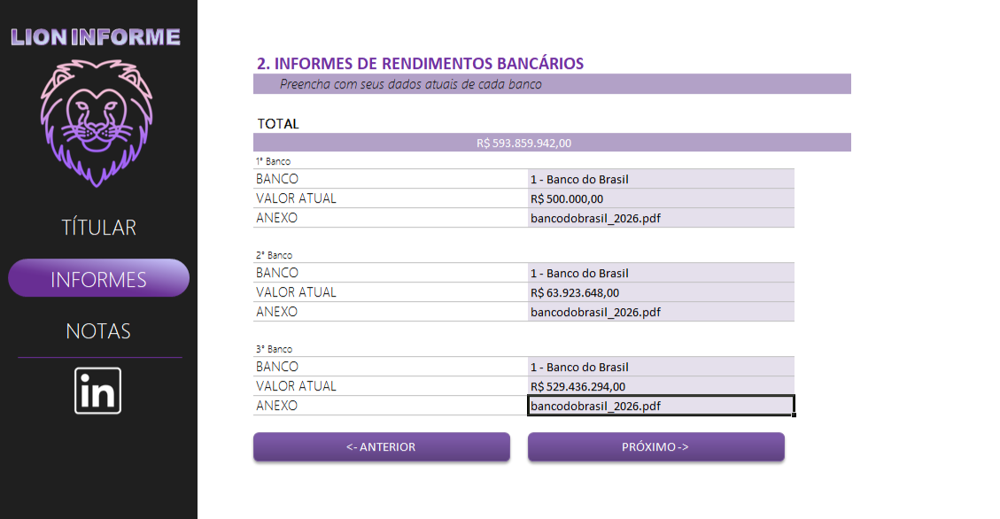
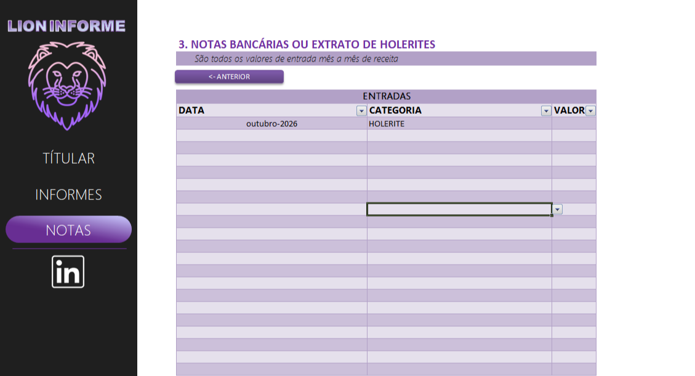

# 🦁 Lion Informe

Planilha interativa em Excel para organizar, em um só lugar, os dados necessários para a declaração de imposto de renda de pessoa física. A navegação é feita por botões, sem precisar mexer em abas manualmente.

## 📸 Telas

| 1. Titular | 2. Informes | 3. Notas |
|---|---|---|
|  |  |  |

## ✨ Funcionalidades

- **Titular:** cadastro dos dados da pessoa física (nome, CPF, nascimento, endereço, contatos e perguntas de verificação como dependente e residência no exterior).
- **Informes:** registro dos rendimentos bancários por banco, com valor atual, anexo e **total somado automaticamente**.
- **Notas:** tabela de entradas mês a mês (data, categoria e valor), com filtros e lista suspensa de categorias.
- **Navegação por botões** (`PRÓXIMO ->` / `<- ANTERIOR`) e menu lateral.
- **Link direto para o LinkedIn** pelo ícone no menu lateral.

## 🛠️ Tecnologias

- Microsoft Excel (fórmulas, tabelas, validação de dados, botões/hiperlinks)
- Ícones externos (logo e LinkedIn)

## ▶️ Como usar

1. Baixe o arquivo `LionInforme.xlsx` (ou `.xlsm`, se tiver macros) neste repositório.
2. Abra no Microsoft Excel.
3. Se aparecer o aviso de segurança, clique em **Habilitar conteúdo** para os botões funcionarem.
4. Preencha as telas na ordem: **Titular → Informes → Notas**.

> ⚠️ Os dados mostrados nas imagens são **fictícios**, apenas para demonstração.

## 📁 Estrutura do repositório

```
lion-informe/
├── LionInforme.xlsx
├── README.md
└── imagens/
    ├── titular.png
    ├── informes.png
    └── notas.png
```

## 👩‍💻 Autora

**Karolina Elizabete**

